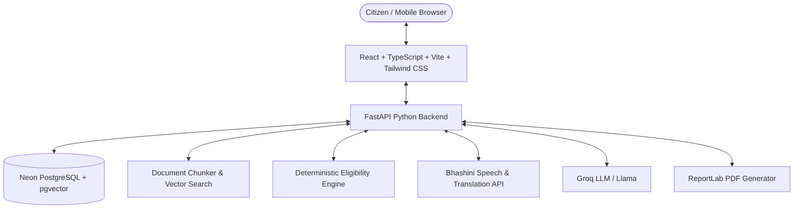

# 🏛️ JanSahayak (जनसहायक)

> **"अपनी भाषा में अपनी स्थिति बताएं। जानें किन सरकारी योजनाओं के आप पात्र हैं और आवेदन तैयार करें।"**  
> *"Tell us about your situation in your own language. Discover government schemes you may qualify for and get help preparing your application."*

---

## 🌟 Overview

**JanSahayak** is a multilingual, citizen-first Indian civic-tech platform designed to bridge the gap between welfare policies and citizens across India. Millions of eligible citizens—especially farmers, rural households, students, women, gig workers, low-income families, and senior citizens—miss out on welfare schemes due to complex bureaucratic jargon, language barriers, unawareness of document requirements, and confusing application procedures.

JanSahayak provides:
1. **Multilingual Scheme Discovery & Comparison**: Search and compare central and state government schemes in regional Indian languages.
2. **Deterministic Eligibility Engine**: Explicit, rule-based qualification assessments without AI hallucinations or false assurances.
3. **Grounded Source-Backed AI Assistant (RAG)**: Conversational exploration of verified government scheme documents with citations, page numbers, and official source links.
4. **Guided Application & Document Checklist**: Step-by-step preparation of applications and verification of required documents with accepted alternatives.
5. **RTI & Grievance Drafting**: Structured, legally grounded drafting for Right to Information (RTI) requests and public grievances (CPGRAMS / state portals).
6. **Voice-First Interaction (Bhashini Integration)**: Speech recognition, translation, and text-to-speech for regional Indian languages.
7. **Citizen Privacy by Design**: Zero unnecessary collection of Aadhaar numbers, private financial credentials, or sensitive documents.

---

## 🏗️ Architecture & Technology Stack



### Frontend
- **Framework**: React 18+ with TypeScript & Vite
- **Styling**: Tailwind CSS with custom Indian Civic-Tech design tokens
- **Routing**: React Router
- **Icons**: Lucide Icons
- **Forms & Validation**: React Hook Form + Zod
- **Deployment**: Vercel

### Backend
- **Framework**: Python 3.11+ with FastAPI
- **Database ORM & Migrations**: SQLAlchemy & Alembic
- **Validation**: Pydantic v2
- **Testing**: Pytest
- **PDF Generation**: ReportLab
- **Deployment**: Render

### Database & Search
- **Primary Database**: Neon Serverless PostgreSQL
- **Semantic Retrieval**: `pgvector` for document embeddings
- **Full-Text Search**: PostgreSQL FTS with GIN indexes

### AI, Speech & NLP
- **Regional Speech & Translation**: Bhashini APIs (STT, NMT, TTS)
- **Language Models**: Groq Cloud API (fast inference for grounded RAG)
- **Eligibility Engine**: Deterministic Python rules engine (strictly non-hallucinatory)

---

## 🎨 Visual Design System

JanSahayak uses a warm, civic, and accessible visual language:
- **Warm Ivory Background**: `#FAF8F2`
- **Ink Navy Primary Text**: `#192A46`
- **Leaf Green Actions**: `#18794E`
- **Saffron Accent**: `#E9A23B`
- **Soft Sky Blue Surface**: `#DCECF7`
- **Soft Mint Surface**: `#E1F2E8`
- **Typography**: Manrope (English/UI) and Noto Sans Devanagari (Indian scripts)

---

## 📁 Repository Structure

```text
jansahayak/
├── frontend/             # React + TypeScript + Vite frontend
│   ├── src/
│   │   ├── components/   # Reusable accessible UI components
│   │   ├── pages/        # Route pages (Discovery, Eligibility, RTI, Dashboard, etc.)
│   │   ├── layouts/      # MainLayout, CitizenLayout, AdminLayout
│   │   ├── services/     # API clients (Auth, Schemes, Bhashini, Assistant)
│   │   ├── hooks/        # Custom React hooks (useAuth, useVoice, useEligibility)
│   │   ├── types/        # TypeScript interfaces and schemas
│   │   └── styles/       # Tailwind & custom CSS tokens
│   ├── public/           # Static assets, fonts, icons
│   ├── package.json
│   └── .env.example
├── backend/              # Python FastAPI backend
│   ├── app/
│   │   ├── api/          # Route handlers (auth, schemes, eligibility, rti, voice)
│   │   ├── core/         # Config, security, database session, middleware
│   │   ├── models/       # SQLAlchemy models (User, Scheme, Application, RTI, Document)
│   │   ├── schemas/      # Pydantic request/response schemas
│   │   ├── services/     # Business logic
│   │   ├── eligibility/  # Rule-based deterministic evaluation engine
│   │   ├── rag/          # Document chunking, vector search, Groq integration
│   │   └── integrations/ # Bhashini speech/translation & external APIs
│   ├── tests/            # Pytest test suites (unit & integration)
│   ├── requirements.txt
│   ├── alembic.ini
│   └── .env.example
├── docs/                 # System architecture, deployment, and API docs
│   ├── architecture.md
│   ├── deployment.md
│   ├── api-integrations.md
│   └── privacy-and-security.md
├── .gitignore            # Git ignore configuration
└── README.md             # Project documentation
```

---

## 🚀 Phased Roadmap

- [x] **Phase 0**: Project setup, Git initialization, security checks, and GitHub linking.
- [ ] **Phase 1**: Design system, responsive layouts, homepage, and core UI components.
- [ ] **Phase 2**: Backend foundation with FastAPI, Neon PostgreSQL, authentication, and security.
- [ ] **Phase 3**: Scheme catalogue with verified official schemes and deterministic eligibility engine.
- [ ] **Phase 4**: Modular RAG pipeline with document chunking, pgvector search, and Groq LLM.
- [ ] **Phase 5**: Citizen workflows: Application preparation, document checklist, RTI/grievance assistant, and PDF generation.
- [ ] **Phase 6**: Multilingual Bhashini voice and translation integration with robust fallbacks.
- [ ] **Phase 7**: Comprehensive testing, security hardening, and accessibility audit.
- [ ] **Phase 8**: Production deployment (Neon DB, Render backend, Vercel frontend).
- [ ] **Phase 9**: Meta WhatsApp Cloud API integration for conversational citizen assistance.

---

## 🔒 Security & Privacy Commitments

- **No Unauthorized Data**: Never collects Aadhaar numbers, biometric data, or banking credentials by default.
- **Privacy by Design**: Role-based access control, parameterized queries, CSRF and secure cookie protections.
- **Transparent Citations**: Every scheme rule or AI response references official government orders, portals, or guidelines.

---

## 📄 License

This project is licensed under the MIT License.
