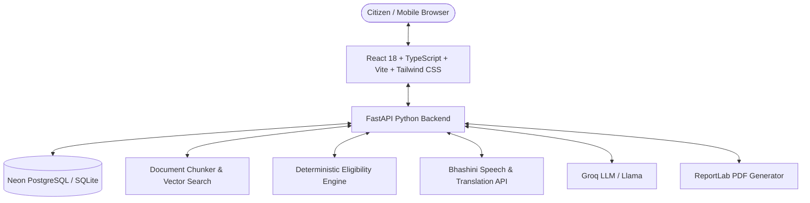

# 🏛️ JanSahayak (जनसहायक)

> **"अपनी भाषा में अपनी स्थिति बताएं। जानें किन सरकारी योजनाओं के आप पात्र हैं और आवेदन तैयार करें।"**  
> *"Tell us about your situation in your own language. Discover government schemes you may qualify for and get help preparing your application."*

---

## 🌟 Overview

**JanSahayak** is a complete, multilingual Indian citizen-services platform that bridges the gap between welfare policies and citizens across India. Millions of eligible citizens—especially farmers, rural households, students, women, gig workers, low-income families, and senior citizens—miss out on welfare schemes due to complex bureaucratic jargon, language barriers, unawareness of document requirements, and confusing application procedures.

JanSahayak provides:
1. **Multilingual Scheme Discovery & Comparison**: Search and compare central and state government schemes in regional Indian languages.
2. **Deterministic Eligibility Engine**: Explicit, rule-based qualification assessments in Python without AI hallucinations or false assurances.
3. **Grounded Source-Backed AI Assistant (RAG)**: Conversational exploration of verified government scheme documents citing exact authorities, page numbers, and official portal links.
4. **Guided Application & Document Checklist**: Step-by-step preparation of applications and verification of required documents with accepted alternatives.
5. **RTI & Grievance Drafting**: Structured, legally grounded drafting for Right to Information (RTI) requests and public grievances (CPGRAMS / state portals) with instant PDF generation.
6. **Voice-First Interaction (Bhashini Integration)**: Speech recognition, translation, and text-to-speech for regional Indian languages with browser Web Speech fallbacks.
7. **Citizen Privacy by Design**: Zero collection of Aadhaar numbers, private financial credentials, or sensitive documents. Strict data isolation between citizen accounts.

---

## 🏗️ Architecture & Technology Stack



### Frontend
- **Framework**: React 18+ with TypeScript & Vite
- **Styling**: Tailwind CSS with custom Indian Civic-Tech design tokens
- **Routing**: React Router SPA
- **Icons**: Lucide Icons
- **Deployment**: Vercel

### Backend
- **Framework**: Python 3.11+ with FastAPI
- **Database ORM & Migrations**: SQLAlchemy & Alembic
- **Validation**: Pydantic v2
- **Testing**: Pytest (100% passing test suite)
- **PDF Generation**: ReportLab
- **Deployment**: Render

### Database & Search
- **Production Database**: Neon Serverless PostgreSQL
- **Local Dev / Testing**: Embedded SQLite with StaticPool zero-config fallback
- **Semantic Retrieval**: pgvector for document embeddings
- **Full-Text Search**: PostgreSQL FTS with GIN indexes

---

## 🎨 Visual Design System

JanSahayak uses a warm, civic, and accessible visual language:
- **Warm Ivory Background**: `#FAF8F2`
- **Ink Navy Primary Text**: `#192A46`
- **Leaf Green Actions**: `#18794E`
- **Saffron Accent**: `#E9A23B`
- **Soft Sky Blue Surface**: `#DCECF7`
- **Soft Mint Surface**: `#E1F2E8`
- **Typography**: Manrope (English/UI) and Noto Sans Devanagari (Indian scripts)

---

## 📁 Repository Structure

```text
JANSAHAYAK/
├── frontend/                     # React + TypeScript + Vite frontend
│   ├── src/
│   │   ├── components/           # Reusable civic UI components (Buttons, Cards, Badges, Alerts, Navbar, Footer)
│   │   ├── pages/                # Routes: Home, Schemes, Detail, Eligibility, Compare, Assistant, Apps, RTI, Grievances, Dashboard, Login, Register, Admin, Privacy
│   │   ├── services/             # Centralized API client (api.ts)
│   │   ├── context/              # AuthContext & LanguageContext
│   │   ├── types/                # Strict TypeScript schemas
│   │   └── index.css             # Tailwind design tokens
│   ├── public/                   # Static assets & icons
│   ├── package.json
│   ├── vercel.json               # SPA routing rewrite for Vercel
│   └── .env.example
├── backend/                      # Python FastAPI backend
│   ├── app/
│   │   ├── api/                  # REST routers (auth, schemes, eligibility, assistant, voice, applications, rti, grievances, dashboard, feedback, admin, health)
│   │   ├── core/                 # Config (Pydantic Settings), PBKDF2 hashing, JWT security
│   │   ├── db/                   # SQLAlchemy engine, session, and verified seed data
│   │   ├── models/               # SQLAlchemy models (User, Scheme, Draft, Feedback, AuditLog)
│   │   ├── schemas/              # Pydantic V2 request/response schemas
│   │   └── services/
│   │       ├── eligibility/      # Deterministic Python rules engine
│   │       ├── ai/               # Groq grounded LLM integration & prompt fencing
│   │       ├── rag/              # Verified passage retrieval
│   │       ├── bhashini/         # Bhashini ASR, NMT, TTS & browser fallback
│   │       └── documents/        # ReportLab PDF generator (Reports, RTI, Grievances)
│   ├── tests/                    # Pytest test suites (test_auth_and_api, test_eligibility)
│   ├── alembic/                  # Alembic database migrations
│   ├── requirements.txt
│   └── .env.example
├── docs/                         # Technical & deployment documentation
│   ├── architecture.md           # High-level architecture & component diagram
│   ├── api-integrations.md       # External APIs (Groq, Bhashini, Neon)
│   ├── deployment.md             # Step-by-step Render, Vercel & Neon setup
│   ├── data-verification.md      # Verified scheme provenance & source metadata
│   └── security-and-privacy.md   # Security safeguards & privacy charter
├── .gitignore
└── README.md
```

---

## ⚡ Quick Start: Running Locally on Windows

### 1. Start the Backend API

```powershell
cd "c:\Users\SHIVAY AGARWAL\Desktop\JANSAHAYAK\backend"

# (Optional) Set environment variables if you have Groq API key:
# $env:GROQ_API_KEY="your_groq_api_key_here"

# Start FastAPI server on port 8000
python -m uvicorn app.main:app --reload --port 8000
```
- API Documentation (Swagger): [http://localhost:8000/docs](http://localhost:8000/docs)
- Health Check: [http://localhost:8000/api/health](http://localhost:8000/api/health)

### 2. Start the Frontend

```powershell
cd "c:\Users\SHIVAY AGARWAL\Desktop\JANSAHAYAK\frontend"
npm run dev
```
- Open browser at [http://localhost:5173](http://localhost:5173)

### 3. Run Automated Tests

```powershell
cd "c:\Users\SHIVAY AGARWAL\Desktop\JANSAHAYAK\backend"
python -m pytest tests/
```

### 4. Build Frontend for Production

```powershell
cd "c:\Users\SHIVAY AGARWAL\Desktop\JANSAHAYAK\frontend"
npm run build
```

---

## 🚀 Cloud Deployment Guide

See [`docs/deployment.md`](file:///c:/Users/SHIVAY%20AGARWAL/Desktop/JANSAHAYAK/docs/deployment.md) for full instructions:
1. **Neon PostgreSQL**: Create database project and copy connection string into Render `DATABASE_URL`.
2. **Render Backend**: Connect GitHub repository `ShivayAgarwal08/jansahayak`, set root directory to `backend`, start command `uvicorn app.main:app --host 0.0.0.0 --port $PORT`.
3. **Vercel Frontend**: Connect repository, set root directory to `frontend`, add `VITE_API_BASE_URL` pointing to Render backend URL.

---

## 🔒 Security & Privacy Commitments

- **No Sensitive Identifiers**: Never collects or stores Aadhaar numbers, biometrics, or bank passwords.
- **Data Isolation**: Strict user-level authorization checks on every query.
- **Right to Erasure**: Citizens can delete individual drafts or permanently wipe their account from the dashboard.
- **Transparent Citations**: Every scheme and RAG response cites verified `.gov.in` sources and notifications.

---

## 📄 License

This project is licensed under the MIT License.
