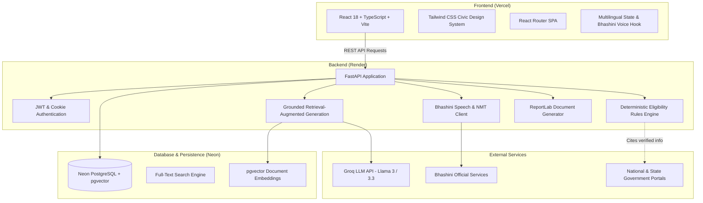

# JanSahayak System Architecture

## 1. High-Level Architecture Overview

JanSahayak is designed as a modular, secure, citizen-centric platform connecting citizens to verified Indian welfare schemes.

## 2. Core Modules

### 2.1 Frontend (`frontend/`)
- **Technology**: React 18, TypeScript, Vite, Tailwind CSS, React Router, Lucide Icons.
- **Design Tokens**:
  - Background: `#FAF8F2` (Warm Ivory)
  - Navy: `#192A46` (Deep Ink)
  - Green: `#18794E` (Civic Leaf Green)
  - Saffron: `#E9A23B` (Vibrant Saffron)
  - Soft Mint: `#E1F2E8`
  - Soft Blue: `#DCECF7`
- **Component Hierarchy**:
  - `src/components/layout`: Navbar with Language Switcher, Footer, Breadcrumbs.
  - `src/components/common`: Button, Card, Badge, Modal, Alert, LoadingSpinner, Tabs.
  - `src/components/schemes`: SchemeCard, SchemeFilter, EligibilityBadge, DocumentChecklist.
  - `src/pages`: Home, Schemes, SchemeDetail, EligibilityCheck, Assistant, ApplicationPrep, RTI, Grievances, Dashboard, Login, Register, Admin, Privacy.

### 2.2 Backend (`backend/app/`)
- **Framework**: FastAPI (Python 3.11).
- **Domain Boundaries**:
  - `core/`: Configuration via Pydantic Settings, password hashing, JWT handlers, database session management.
  - `models/`: SQLAlchemy declarative ORM models with SQLite/Postgres compatibility.
  - `schemas/`: Pydantic V2 schemas with strict request/response validation.
  - `api/`: Clean REST endpoints grouped by business domain.
  - `services/eligibility/`: Deterministic rules evaluator. Evaluates strict criteria (age, income, landholding, category, gender) and returns `{status, met_conditions, unmet_conditions, unknown_conditions, official_citations}`.
  - `services/ai/` & `services/rag/`: Retrieval from verified scheme documents, Groq inference with strict prompt fences against hallucination, fallback when API keys are unconfigured.
  - `services/bhashini/`: Modular client supporting STT, NMT, and TTS with graceful fallback.
  - `services/documents/`: ReportLab PDF generation for Citizen Summary Reports, RTI Petitions, and Grievance Drafts.

### 2.3 Database Layer (`backend/app/models/`)
- **Multi-Environment Support**: Seamless operation on SQLite (for quick local zero-config testing) and Neon PostgreSQL (for hosted production).
- **Core Entities**:
  - `users`: Citizen accounts with hashed passwords, role (`citizen`, `admin`), language preference.
  - `schemes`: Verified government schemes with ministry, scope, state, criteria rules, benefits, and official links.
  - `scheme_sources`: Provenance metadata, official URLs, verification dates, gazette/order references.
  - `eligibility_rules`: Structured rule definitions for evaluation.
  - `saved_schemes`: Citizen bookmarks.
  - `assessment_history`: Previous eligibility assessments for the citizen.
  - `application_drafts`: Saved progress on scheme applications.
  - `rti_drafts`: Right to Information requests prepared by citizens.
  - `grievance_drafts`: Public grievance petitions for CPGRAMS / state portals.
  - `document_checklists`: Citizen document readiness records.
  - `knowledge_documents` & `document_chunks`: Chunks of official scheme guidelines for RAG retrieval.
  - `feedbacks`: Citizen error reports and feedback.
